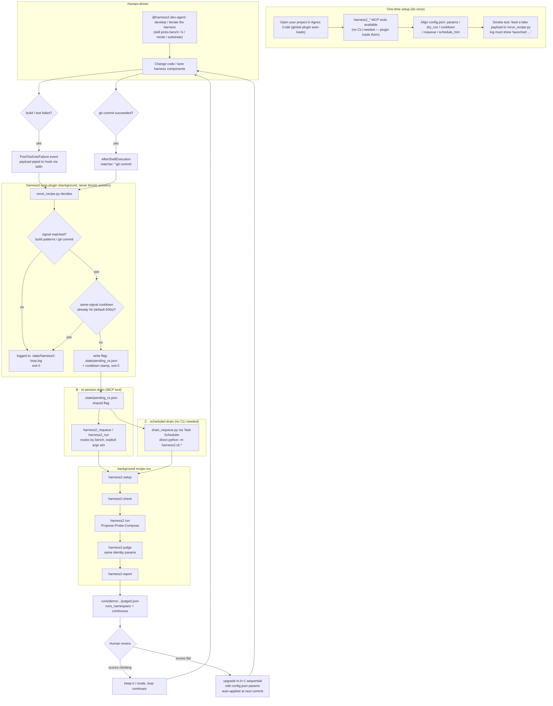
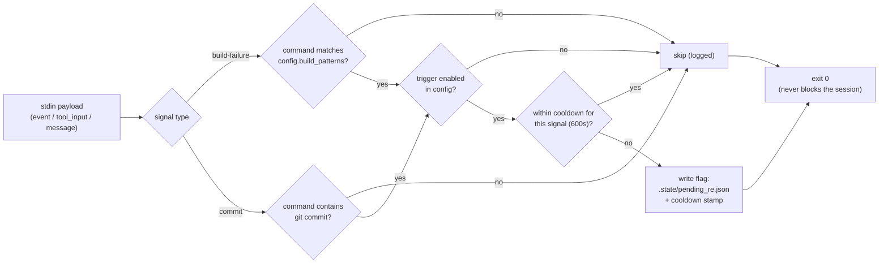

# harness2-loop

A local Agnes Code **plugin** that turns the `harness2` integration into a
**continuous-improvement closed loop**. It re-runs the
`recipes/harness2-any-project.yaml` recipe automatically whenever a build/test
step fails or a commit lands, so the harness keeps refining the project over
time instead of waiting for a human to re-invoke it.

This is the fifth integration artifact on top of: the MCP server
(`mcp_server/harness2_mcp.py`), the recipe (`recipes/harness2-any-project.yaml`),
the custom agent (`.agents/agents/harness2-dev-agent.md`), and the skill
(`.agents/skills/harness2-develop/SKILL.md`).

## How it works (matches the official Agnes hooks model)

Hooks are discovered from a plugin's `hooks/hooks.json` and run as local
commands when a matching lifecycle event fires:

| File | Role |
|------|------|
| `plugin.json` | Manifest. Identifies the plugin (`name: harness2-loop`). |
| `hooks/hooks.json` | Maps events → commands. |
| `scripts/rerun_recipe.py` | The trigger recorder (reads the payload, decides, writes the `pending_re.json` flag). |
| `scripts/drain_requeue.py` | Path C scheduler drain: consumes the flag and runs the pipeline via direct `python -m harness2.cli.*` (no CLI binary needed). |
| `scripts/rerun.cmd` | Windows fallback if the hook runner has no POSIX `sh -c`. |
| `config.json` | Per-machine knobs (recipe, params, cooldown, triggers, requeue, schedule_hint). |
| `.state/` | Runtime logs, cooldown markers, and `pending_re.json` (created on first run). |

### Events used

| Event | Why |
|-------|-----|
| `PostToolUseFailure` | Fires after a tool call fails. `AfterShellExecution`/`AfterFileEdit` only fire on **success**, so a failed build must be caught here. No `matcher` → runs on every tool failure, filtered in-script to only build/test-looking commands. |
| `AfterShellExecution` with `matcher: ^git\s+commit` | Fires after a successful shell command that is a `git commit`. This is the commit trigger. |

A bare `"*"` matcher is **invalid** in Agnes (the whole rule is silently
skipped), so the build-failure rule deliberately omits `matcher` and does the
filtering in `rerun_recipe.py` instead.

### Payload → decision

The hook command receives the event payload on **stdin** (`event`,
`session_id`, `tool_name`, `tool_input.command`, `message`,
`working_dir`). `rerun_recipe.py`:

1. only fires on build/test signals for `build-failure`
   (`config.build_patterns`) and on `git commit` for `commit`;
2. applies a per-signal **cooldown** (`config.cooldown_seconds`, default 600s)
   so the recipe's own builds/commits do not re-trigger the loop;
3. writes a **pending trigger flag** to `.state/pending_re.json` and returns
   immediately.

The script is observation-only: it always exits `0` and never blocks the
session (a failing hook is logged by Agnes, not fatal).

### Flag protocol (B + C, no external CLI needed)

Desktop Agnes Code ships a GUI app (`AgnesCode.exe`) plus a backend daemon
(`resources\bin\agnesd.exe`), but **no headless CLI binary** — so a hook
cannot `spawn` `Agnes Code run --recipe …` directly. The plugin therefore
uses a **two-tier flag protocol**:

| Tier | Who | How |
|---|---|---|
| **B — in-session drain** | Agnes Code agent (MCP tool) | `mcp_server/harness2_mcp.py` exposes `harness2_requeue`: it reads `pending_re.json`, routes by `bench` (demo→`harness2-demo`, jb/lab/wb→`harness2-run`, ags-demo→`harness2-agns-demo`), merges the flag's params into the tool call (explicit args win), drains the flag, and returns the pipeline result. `harness2_run` also *notices* a pending flag and appends a `[requeue] NOTE` so the agent can drain it. |
| **C — scheduled drain** | OS scheduler | `scripts/drain_requeue.py` is invoked periodically (Windows Task Scheduler via `config.schedule_hint.windows_task_sch`, or any cron). It consumes the flag, runs the same pipeline via direct `python -m harness2.cli.*` (zero external CLI), logs to `recipe-runs.log`, and deletes the flag. No flag → safe no-op. |

Both tiers share the **same flag file**, so they are naturally mutually
exclusive (whichever runs first consumes it) and idempotent.

## Flow diagrams

> **互動版（推薦）**：spec 級零依賴原生 SVG 全鏈路流程圖
> [.agnes/artifacts/flowcharts/harness2-loop-flowchart.html](../../.agnes/artifacts/flowcharts/harness2-loop-flowchart.html)
> （資料驅動格點 + 顯式路由 + ISO 5807 符號 + 滾輪縮放 / 拖曳平移 / ⛶ 全圖適配 / 🔝 起點置頂 + 內建幾何自審計徽章）。
> 三層審計管線：`node scripts/verify-flowchart-spec.js .agnes/artifacts/flowcharts/harness2-loop-flowchart.html`。
> 下方為等價 Mermaid 靜態版（無 Node 環境時可直接貼到支援 Mermaid 的維基 / GitHub）。

### Closed loop (whole system)



### Hook decision logic (every event)



Key point: every path ends in `exit 0` (observation-only). Worst case is "this re-run was skipped", never a blocked session. Blocking tool calls is a separate `PreToolUse` policy and must not be mixed into this plugin.

## Enable it

The plugin lives under the project plugins dir, so Agnes Code loads it
automatically when it starts from this project:

```
<project>/.Agnes Code/plugins/harness2-loop/
```

Verify detection (the name `harness2-loop` should appear):

```powershell
Get-ChildItem "<project>\.Agnes Code\plugins\harness2-loop" -Recurse
```

### Global install (applies to every project)

To have the closed loop work while you develop **any** project (not just
this repository), copy the plugin into the user-level plugins dir — Agnes
Code loads it for all projects:

```powershell
# 1. copy the plugin to the global location
robocopy "<project>\.Agnes Code\plugins\harness2-loop" `
  "$HOME\.Agnes Code\plugins\harness2-loop" /E

# 2. verify
Get-ChildItem "$HOME\.Agnes Code\plugins\harness2-loop" -Recurse
```

Then, in the **global** `config.json`:

- keep `repo_root` pointing at the harness2 repository (that is where the
  recipe and the `harness2` CLI modules live);
- point `schedule_hint.windows_task_sch` at the **global** drain script
  path;
- leave `requeue.flag_path` as `.state/pending_re.json` (the global hook
  writes the flag under the global plugin dir).

The MCP server (`mcp_server/harness2_mcp.py`) checks **both** locations for
the pending flag — global first, project copy as fallback — so `harness2_requeue`
drains whichever one the hook wrote. This means: develop your own project,
open Agnes Code, and the loop is active; no need to open the harness2 repo.

To **disable** it without deleting files, add its name to `disabledPlugins` in
the Agnes Code settings (project `<project>/.config/Agnes Code/settings.json`,
or user `~/.config/Agnes Code/settings.json`):

```json
{ "disabledPlugins": ["harness2-loop"] }
```

## Tuning

Edit `config.json`:

- `repo_root` / `recipe` – where the pipeline runs and which recipe to re-run.
- `params` – the `--params` passed to the recipe (bench, k, mode, substrate,
  seed, dry_run, min_gain, model). Set `dry_run: "true"` to dry-run the loop.
- `cooldown_seconds` – guard against self-triggering (raise it if runs are long).
- `build_failure_trigger` / `commit_trigger` – switch each trigger on/off.
- `requeue.flag_path` – where the trigger flag is written/read (B + C share it).
- `schedule_hint` – path C: enable a periodic drain, set `interval_minutes`,
  and pick a `dry_run` policy. On Windows, register the one-liner in
  `windows_task_sch`; the drain runs `scripts/drain_requeue.py`.
- `runs_namespace` – a stable namespace so loop runs share a judged namespace
  (keep it constant so results stay comparable).

## Troubleshooting

- Hook didn't run: confirm the plugin dir is under the *current* project, the
  event name is supported, the matcher regex is valid (no bare `*`), and the
  plugin is not in `disabledPlugins`.
- Hook runs but nothing re-triggers: check `.state/harness2-loop.log` for
  `no build/commit signal`, `within cooldown`, or `disabled in config`.
- Triggered but the recipe didn't run: the hook only *writes* the flag
  (`pending_re.json`). Close the loop by draining it — in-session, call the
  `harness2_requeue` MCP tool; off-session, run the scheduled
  `drain_requeue.py` (or `python -m ... drain_requeue.py` once). A stale
  flag is removed automatically on the next drain.
- A `PostToolUseFailure` hook that wants to *block* must print
  `{"decision":"block","reason":"..."}` to stdout; this plugin only observes,
  so it prints nothing and exits 0.
- Windows: if the hook runner cannot use `sh -c`, point the `command` in
  `hooks/hooks.json` at `scripts/rerun.cmd` instead of the python invocation.
